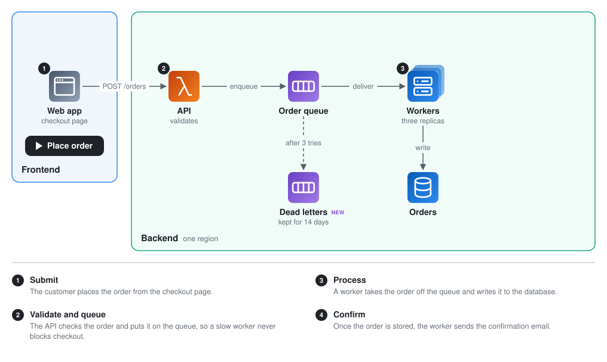

# diagr

Clean diagrams from a YAML file. One file in; out come a static SVG for light mode, one for dark mode, and a
self-contained HTML page where the diagram can play a scenario step by step.

- **Static first.** The SVGs are hand-laid-out on a grid, with rounded orthogonal edges, label pills and tinted
  groups. Icons are inlined and colours are baked in, so they work in READMEs, docs and slides.
- **Interactive on top.** The HTML page has a scenario player: Run, play and pause, step forward and back, scrub,
  speed, keyboard shortcuts. A diagram can have several scenarios, each with its own trigger button. The state at
  each step is computed from the step number, so stepping back and scrubbing show exactly what playing would.
- **One HTML file.** Inline SVG, CSS and JavaScript. No CDN, no framework, nothing to load at runtime.
- **Domain-neutral.** Nothing in the format assumes pipelines or a vendor. Vendor icons go in an icon folder next to
  the diagram.

## Quick start

```sh
uv sync
uv run diagr build examples/order-flow/diagram.yml -o dist
```

This writes `dist/order-flow-light.svg`, `dist/order-flow-dark.svg` and `dist/order-flow.html`:

<picture>
  <source media="(prefers-color-scheme: dark)" srcset="tests/golden/order-flow-dark.svg">
  
</picture>

To start your own, `uv run diagr init my-flow.yml` writes this starter diagram (a shorter order flow than the
example above):

```yaml
id: order-flow
title: Order processing
grid: {col: 200, row: 170}

groups:
  front: {title: Frontend, tone: blue}
  back: {title: Backend, sub: one region, tone: teal}

nodes:
  web: {in: front, at: [0, 0], icon: browser, title: Web app, trigger: Place order}
  api: {in: back, at: [1, 0], icon: function, title: API, sub: validates}
  queue: {in: back, at: [2, 0], icon: queue, title: Order queue}
  db: {in: back, at: [3, 0], icon: database, title: Orders}

edges:
  web -> api: POST /orders
  api -> queue: enqueue
  queue -> db: write

scenarios:
  order:
    steps:
      - {title: Submit, at: web, do: [activate web, draw web->api, done web]}
      - {title: Queue, at: api, do: [activate api 400ms, draw api->queue, done api]}
      - {title: Store, at: db, do: [draw queue->db, activate db 300ms, done db]}
```

In a README, use both static files so the image follows the reader's theme:

```html
<picture>
  <source media="(prefers-color-scheme: dark)" srcset="order-flow-dark.svg">
  
</picture>
```

## CLI

| Command | What it does |
|---|---|
| `diagr init [FILE] [--id ID]` | Write a starter diagram (default `diagram.yml`); never overwrites |
| `diagr build FILE... [-o DIR] [--theme T] [--debug]` | Write the two SVGs and the HTML page for each file; `--debug` adds the grid and route overlay to the page (G toggles it) |
| `diagr watch FILE... [-o DIR] [--theme T] [--interval S] [--debug] [--serve] [--port P]` | Rebuild when the file, its icon folders or its theme file change; `--serve` also serves the output at `http://127.0.0.1:8001/`, and open pages reload on each rebuild, keeping the scenario, step and scroll position |
| `diagr expand FILE [-o OUT]` | Print the diagram with its components expanded into plain groups, nodes and edges; the output is a valid diagram that builds to the same files |
| `diagr check FILE... [--theme T] [--strict] [--format json]` | Validate; problems are printed as `file:line:col`, or as JSON on stdout |
| `diagr icons [FILE]` | List the core icons, plus the icon folders of `FILE` if given |
| `diagr schema [-o FILE]` | Print the JSON Schema (`schema/diagr.schema.json`) |
| `diagr --version` | Print the installed version |

`--theme` on the command line is resolved against the current folder; `theme:` in a diagram against the diagram's
folder.

Add `# yaml-language-server: $schema=<path>/diagr.schema.json` at the top of a diagram for autocomplete in
editors that support it.

## Player keys

Space plays or pauses. Left and Right go to the previous or next step; with Shift they move one frame. Home resets,
End jumps to the end. Clicking a step in the list jumps to it. With several scenarios, the buttons above the progress
bar switch between them.

## Development

```sh
uv sync
uv run ruff check .
uv run ruff format --check .   # or: uv run ruff format .
uv run pyright
uv run python -m unittest discover -s tests -t .
```

`tests/golden/` holds the expected output of every example. After a change that is meant to alter the output, run
`DIAGR_UPDATE_GOLDEN=1 uv run python -m unittest tests.test_examples` and review the diff. After changing the format,
regenerate the schema with `uv run diagr schema -o schema/diagr.schema.json`; a test fails if it is out of date.
`.github/workflows/ci.yml` runs all of this on every push and pull request.

## Docs

The docs site is built with MkDocs Material and deployed to GitHub Pages by `.github/workflows/docs.yml`. The
examples are built from `examples/` each time the site is built.

```sh
uv sync --group docs
uv run mkdocs serve          # live preview
uv run mkdocs build --strict # writes site/
```

- [Diagram format and effects](docs/format.md)
- [Themes and icons](docs/themes-and-icons.md)
- [Examples](examples/): `order-flow`, `cloud-architecture` (bus, fan-out, dead-letter queue, retries),
  `dashboard-refresh` (a pipeline with progress cells), `multi-region` (nested groups, a component used twice, three scenarios)

## Layout of this repo

| Path | What |
|---|---|
| `src/diagr/` | The package: parser, validator, layout, scenario compiler, renderers, themes, core icons |
| `examples/` | Example diagrams |
| `schema/` | Generated JSON Schema |
| `tests/` | Unit tests and golden files for the examples |
| `tools/measure_text.py` | Regenerates the text width table from installed fonts (needs Chrome) |

## License

MIT, see [LICENSE](LICENSE).
